# CAMPUS BUS — Bus Reservation System for Schools, Colleges and Universities

KTU S3 B.Tech CSE · Object Oriented Programming course project
**Java 17 · Swing · HTML5 / CSS3 / JavaScript (JavaFX WebView) · JDBC · MySQL 8**

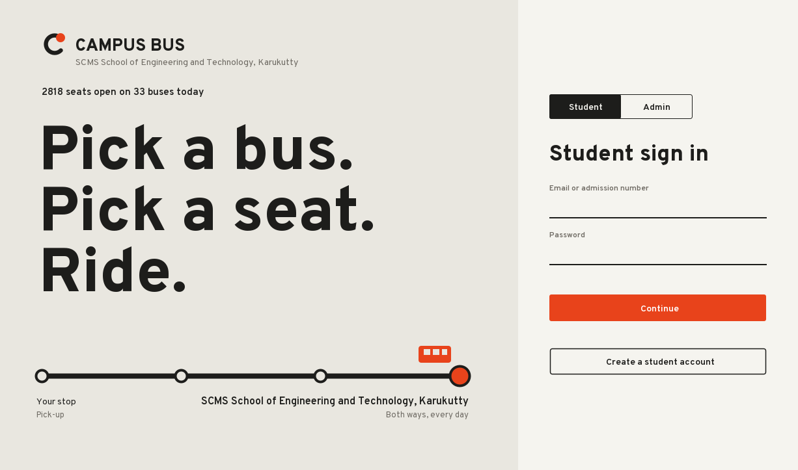

A desktop application for any educational institution's bus service. Students find a bus that passes their stop, see the time it reaches that stop, pick a seat on a picture of the bus (green = free, red = booked) and get a bus pass. The transport office sets one timetable for the whole institution, manages buses, routes, students, reservations and administrator accounts, and sees who sits where.

This implementation **expands the initial proposal (PPT)**: every module, class, method and OOP concept from the PPT is kept; the seat map, route lines, two-way buses, timetable, live position estimate, bus pass and admin analytics are additions.

### Screenshots

Taken from the running app with synthetic test accounts (no real student data).

| Student | |
|---|---|
| 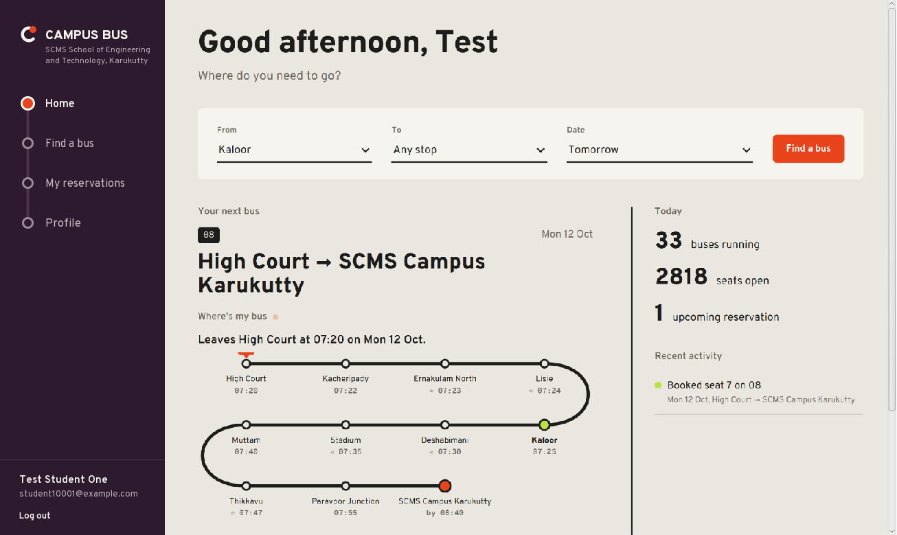 Home: next bus and where it is | 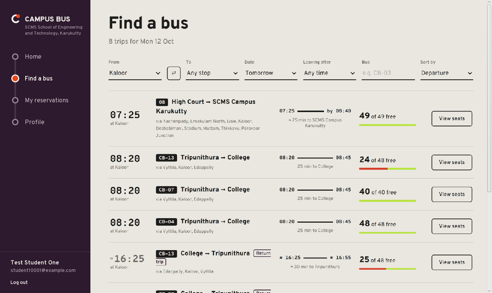 Find a bus from any stop |
| 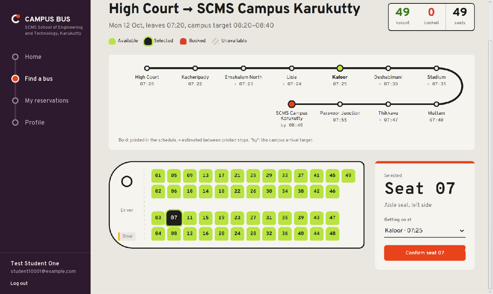 Seat map and stop picker | 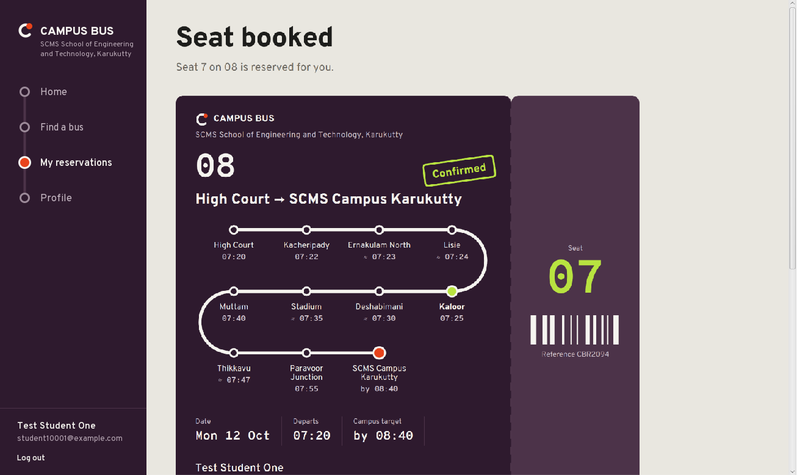 Bus pass |
| 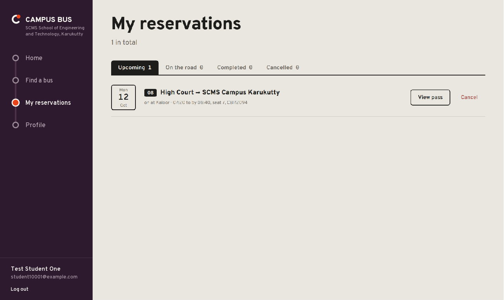 My reservations | |

| Admin | |
|---|---|
| 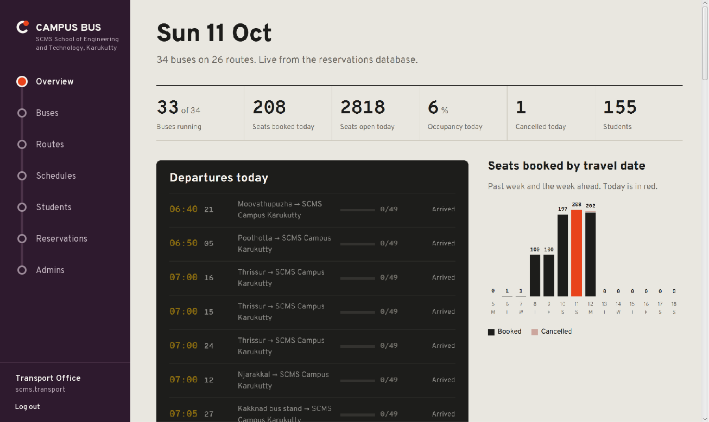 Overview | 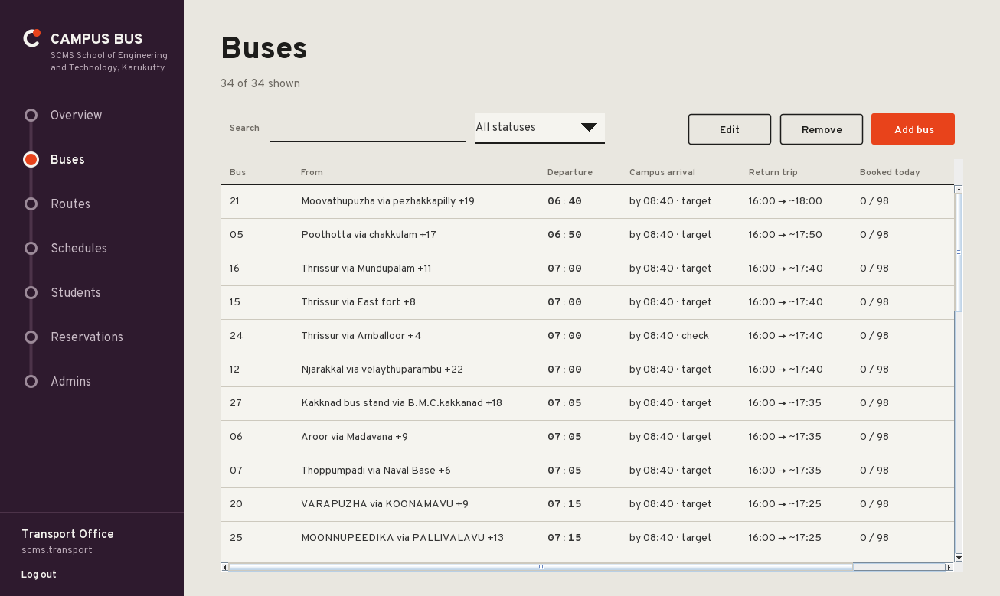 Buses |
| 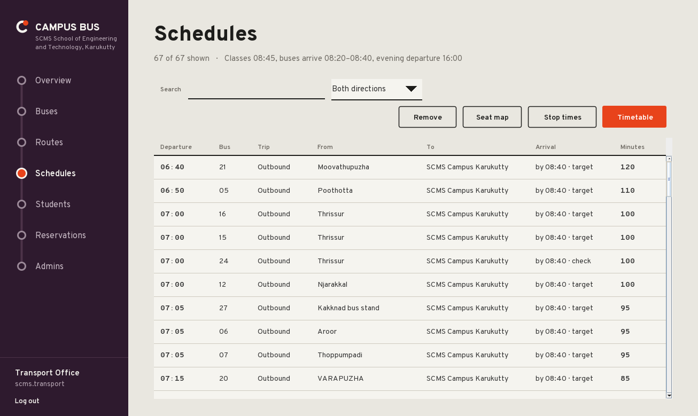 Schedules | 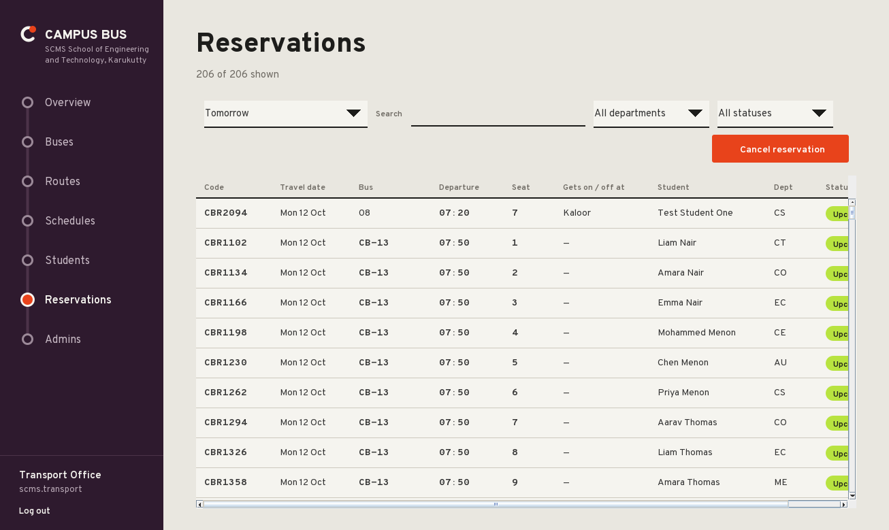 Reservations with department filter |
| 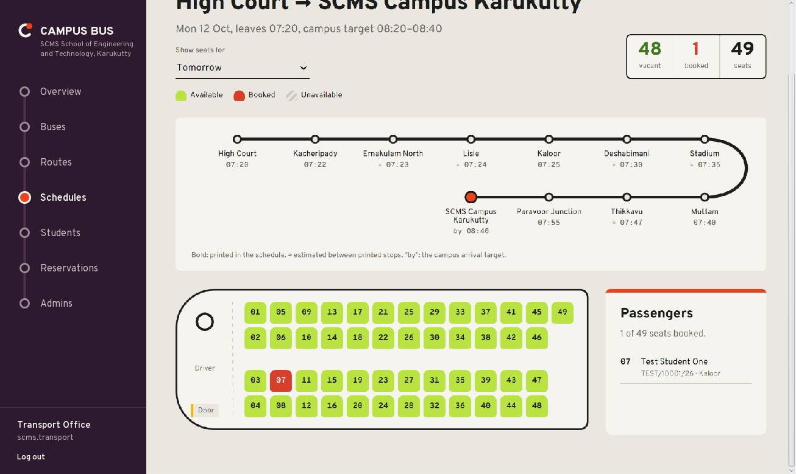 Seat map with passenger list | |

---

## 1. Quick start

**You need:** JDK 17+, Apache Maven 3.8+, MySQL 8 (server running).

1. Copy `db.properties.example` to `db.properties` and fill in your MySQL user and password.
   `db.properties` is git-ignored, so the password never enters the repository. Every value can also come from an environment variable (`CAMPUS_BUS_DB_PASSWORD`, …) or a `-D` option (`-Ddb.password=…`).
2. Start the app. On Windows the easiest way is to double-click **`run-campus-bus.cmd`** in the project folder: it checks Java, Maven and `db.properties`, then opens the window and explains any problem. The terminal waits while the app is open and returns when you close it.

PowerShell (the default Windows terminal):

```powershell
Set-Location D:\campus-bus
.\run-campus-bus.cmd
```

Command Prompt (`cmd.exe`):

```bat
cd /d D:\campus-bus
run-campus-bus.cmd
```

Any system, with Maven directly: `mvn clean compile exec:java` from the project folder (later launches: `mvn exec:java`). Use your own project folder in place of `D:\campus-bus`.

On the very first launch the app creates an **empty** database from `database/schema.sql`, then opens **Set up your institution**: the institution's name and its first administrator (password typed twice). This screen appears once; after that the app opens at the login screen. More administrators are added inside the admin console, never through a public form. The admin then sets the timetable and imports the bus schedule (Admin → Routes → *Import schedule*, e.g. `database/scms-schedule-2025-08-18.txt`); students create their own accounts.

For a classroom demo with sample data instead, start on a new empty database with `mvn clean compile exec:java -Ddemo=true`: this also loads `database/demo-data.sql` (5 sample routes, 13 buses, 150 students, about 780 reservations). Its passwords are public, so never load it into a real institution's database.

Other ways to run: open the folder as a Maven project in IntelliJ / Eclipse / VS Code and run `com.collegebus.Main` (working directory = project folder, so `db.properties` is found).

### Accounts

| Role | How it is created |
|---|---|
| First administrator | first-run setup (institution name + admin, password typed twice) |
| More administrators | Admin → *Admins* → *Add admin* (only a signed-in admin; the admin sign-in side says so) |
| Students | *Create a student account* on the Student side of the login screen (password typed twice) |

Student sign-in, admin sign-in, student sign-up and admin creation are four separate paths. Passwords are kept simple on purpose: 4-64 characters, no other rules (`User.checkNewPassword`). They are still stored only as salted PBKDF2 hashes.
| Demo data only (`-Ddemo=true`) | `student@college.com` / `student123`; `ananya@college.com`, `student1@college.com` … `student140@college.com` / `pass123` |

No real password is written in this repository. Local demo/test credentials live outside the project folder.

---

## 2. Problem statement

An institution runs many buses for hundreds of students. Handled by hand, nobody knows which seats are free, when the bus reaches a stop, or who is on which bus. A computerised system lets each student reserve a seat on a specific bus, direction and date, and lets the transport office manage the fleet from one place.

## 3. Objectives

1. A simple system for managing bus reservations at any school, college or university.
2. Students can check bus details, timings at their own stop and reserve available seats.
3. Student, bus, route, timetable and reservation records are kept in MySQL.
4. Java OOP concepts applied in a practical application.

## 4. How the buses work (the rules the app enforces)

- **Published times are kept exactly.** Each bus has its own first pick-up time and each stop its printed time; a stop the schedule prints without a time is shown as an estimate (≈), never as a fact. The timetable never moves a printed time.
- **One timetable for the whole institution:** class start, the campus arrival window and one evening departure (SCMS: classes 08:45, buses reach campus 08:20–08:40, everyone leaves at 16:00). When the schedule prints no campus time, the window's end is shown as the **target** ("by 08:40"). Routes whose last printed pick-up is within 20 minutes of the window are flagged for the transport office to confirm.
- **One bus, both ways:** a bus drives its route to the institution in the morning and the same route reversed in the evening (or mornings only). Each direction has its own seats.
- **Every stop has a daily time** (`Stop:minutesFromStart`, or just `Stop` when none is printed). Students see the time the bus reaches *their* stop, and every booking records where the student **gets on** (morning) or **gets off** (evening); the admin passenger list shows it.
- **One seat per student each way, each day** (all morning buses arrive together, so nobody can ride two). One booking per seat per bus/date/direction.
- Bookings open 7 days ahead and close when the bus leaves its first stop; cancelling frees the seat immediately.

## 5. Modules (from the PPT)

| Module | What it does | Where |
|---|---|---|
| Student | Register, update and display student details | `Student`, `StudentDAO`, Login → *Create a student account*, *Profile* |
| Bus | Add / update / remove buses, routes, timetable, capacity | `Bus`, `Route`, `Timetable`, `BusDAO`, Admin → *Buses*, *Routes*, *Schedules* |
| Reservation | Book, view, cancel seats | `Reservation`, `ReservationService`, `ReservationDAO`, *Find a bus*, *My reservations* |
| Availability | Free seats per bus, direction and date | `Bus.checkAvailability()`, `ReservationDAO.bookedSeats()`, seat map |
| Admin | Manage buses, schedules, students, reservations, admins | `Admin`, `AdminDAO`, `AdminDashboard` |

## 6. Features

**Student**
- Create an account (password typed twice; admission number such as `SCS/10001/26`; class such as `S3 CS2`) and sign in with email or admission number
- Home: next bus with **Where's my bus** (position on the route line, last/next stop, minutes to arrival — estimated from the timetable and refreshed every 30 s; buses carry no GPS)
- Find a bus: from / to (⇄ swaps them for the trip home), date (today + 7 days), leaving after, bus number, sort; each result shows the time at *your* stop
- Choose **your stop** (getting on / getting off) when booking
- Seat map drawn as the bus seen from above (driver, door, aisle): available green, booked red, selected, unavailable, yours — with vacant / booked counters
- Bus pass after booking (seat, bus, your stop and its time, route with every stop, reference), printable through the system print dialog
- My reservations: Upcoming / On the road / Completed / Cancelled with inline cancel confirmation
- Profile editing

**Admin (transport office)**
- Overview: buses running, seats booked / open today, occupancy, cancellations, today's departure board, a 14-day bookings chart — all read from MySQL
- Buses: add, edit (route, evening trip yes/no, capacity, status), remove (refused while students hold upcoming seats)
- Routes: add, edit (checked against every bus on it before saving), remove (refused while buses use the route), **Import schedule** from a text file (idempotent, verified by reading back)
- Schedules: every departure both ways; **Timetable** (class start, campus arrival window, evening departure; printed pick-up times never move); **Stop times** for any trip (printed / ≈ estimated / campus target); **Seat map** with the passenger list and each passenger's stop
- Students: search, filter by department (worked out from the class: S3 CS2 → CS; semesters S1–S8), edit, remove (confirmation shows how many upcoming seats are released; the student can no longer sign in)
- Reservations: filter by department and status; loaded one period at a time (today + 7 days, today, tomorrow, last 7 / 30 days), search, filter by status, cancel
- Administrators: add another admin, remove one (never yourself, never the last one)

**Everywhere:** toast notifications, inline form errors, empty states, "database unavailable" states that recover when MySQL returns, loading state, restrained motion.

The pass's bar pattern is **decorative** (generated from the reservation code); it is not a scannable code.

---

## 7. Architecture

```
                    JAVA DESKTOP APP  (Main → first-run setup → LoginFrame)
                              │
          ┌───────────────────┴────────────────────┐
     JAVA SWING                              HTML / CSS / JS  (JavaFX WebView)
     LoginFrame, setup + forms (FormDialog), Home, Find a bus, Seat map,
     Dashboard route-line menu,              Bus pass, My reservations,
     Admin tables (TablePanel), Profile,     Admin overview + seat map / passengers
     Toasts, JOptionPane                           │  window.app = WebBridge
          │                     WebPanel = JFXPanel + WebView (inside Swing)
          └───────────────────┬────────────────────┘
                CollegeBusSystem · ReservationService · Admin   ← business rules (Java)
                              │
              StudentDAO · AdminDAO · BusDAO · ReservationDAO    ← SQL (PreparedStatement only)
                              │
                 JDBC (Connection, PreparedStatement, ResultSet)
                              │
                          MySQL: college_bus_db
```

**How HTML/CSS/JS is integrated:** `WebPanel` is a Swing component (`JFXPanel`) hosting a WebView. It loads `resources/web/index.html` and gives JavaScript a Java object (`WebBridge`) as `window.app`. JavaScript calls e.g. `app.book("3", "2026-10-09", "OUT", "12")`; Java checks the rules, talks to MySQL and returns JSON (`{"ok":true,"data":…}`). JavaScript only draws (SVG route lines, seat grid, pass). The Swing menu tells the web view which page to show; the web page tells Swing which menu item to highlight. Bridge calls check the signed-in role, so a student window cannot run admin calls and never receives other students' names.

### Project structure

```
campus-bus/
├── pom.xml                      Maven build (exec:java launches the app)
├── db.properties.example        copy to db.properties (git-ignored)
├── database/schema.sql          tables, constraints, demo data
├── docs/screenshots/
└── src/
    ├── main/java/com/collegebus/
    │   ├── Main.java
    │   ├── model/    Displayable, User, Student, Admin, Bus, Route, Timetable, Reservation
    │   ├── dao/      StudentDAO, AdminDAO, BusDAO, ReservationDAO, Queries
    │   ├── service/  CollegeBusSystem, ReservationService
    │   ├── gui/      LoginFrame, Dashboard, StudentDashboard, AdminDashboard,
    │   │             WebPanel, WebBridge, TablePanel, FormDialog, Toast, Theme
    │   └── util/     DatabaseConnection, Json
    ├── main/resources/web/      index.html · css/style.css · js/app.js, student.js, admin.js · fonts
    └── test/java/com/collegebus/
        ├── ModelTest.java       validation and rules, no database
        └── DatabaseTest.java    real JDBC/MySQL tests on college_bus_test
```

---

## 8. OOP concepts — where to point in the viva

| Concept | Where | What to say |
|---|---|---|
| **Encapsulation** | `User`, `Student`, `Bus`, `Timetable`, `Reservation` | Fields are `private`; changes go through methods that validate first — `Student.updateStudent()` rejects a 9-digit phone, `Bus.updateBus()` rejects an evening trip that starts before the bus arrives, `Timetable` refuses an arrival window that ends after classes start. |
| **Inheritance** | `User` → `Student`, `User` → `Admin`; `Dashboard` → `StudentDashboard`, `AdminDashboard` | Common fields (id, name, email, password hash) and `checkPassword()` live once in `User`; the menu, page switching and toasts live once in `Dashboard`. |
| **Polymorphism** | `User.getRole()`, `User.openDashboard()`, `displayDetails()`, `Dashboard.open()`, `Bus.getRoute()` | `LoginFrame.signIn()` gets a `User` and calls `user.openDashboard(system)` — a Student opens the student window, an Admin the console, no `if/else` on type. `Json.of()` turns *any* `Displayable` into JSON through `toMap()`. A bus and its `returnTrip()` answer `getRoute()` / `getDeparture()` differently, so search, seat map and pass work for both directions with one code path. |
| **Abstraction** | `abstract class User`, `abstract class Dashboard`, `interface Displayable` | They define *what* subclasses must do (`getRole()`, `openDashboard()`, `open(page)`, `toMap()`), not *how*. |

### PPT methods → code

| PPT | Implemented in |
|---|---|
| `Student.registerStudent() / updateStudent() / displayStudent()` | `model/Student.java` |
| `Bus.addBus() / updateBus() / displayBus() / checkAvailability()` | `model/Bus.java` |
| `Reservation.bookSeat() / cancelBooking() / displayBooking()` | `model/Reservation.java` |
| `Admin.addBus() / removeBus() / manageSchedule() / viewReservations()` | `model/Admin.java` (`manageSchedule` sets the institution timetable) |
| `CollegeBusSystem.searchBus() / manageReservations() / displayDetails()` | `service/CollegeBusSystem.java` |

---

## 9. Database

`college_bus_db` — tables `students`, `admins`, `settings`, `routes`, `buses`, `reservations`.

- Primary keys everywhere; foreign keys `buses.route_id → routes`, `reservations.student_id → students` and `reservations.bus_id → buses` (both `ON DELETE CASCADE`: removing a student frees their seats)
- `CHECK`: capacity 8–60, arrival after departure, evening trip after arrival, seat number > 0
- `UNIQUE` on admission number, email, bus number, admin username
- `settings` holds the institution name and timetable
- Passwords stored as salted PBKDF2-HMAC-SHA256 (600,000 iterations, `User.hash()`), never as text; older SHA-256 or cheaper hashes are upgraded at the next sign-in; the database password is never in the source
- **Double-booking is blocked by MySQL itself:** `reservations.active` is a generated column (`1` while BOOKED, `NULL` when CANCELLED). `UNIQUE (bus_id, travel_date, direction, seat_no, active)` allows one *booked* row per seat, while cancelled rows (NULL) never clash, so a cancelled seat can be booked again. `UNIQUE (student_id, travel_date, direction, active)` stops one student holding two seats in the same direction on the same day.
- Built for real volume: counts are done with `COUNT(*)` in MySQL, the admin reservation list loads one period at a time, and the demo data has 150 students and about 780 reservations (light enough for a demo laptop).
- First-admin setup is one atomic statement (`INSERT … SELECT … WHERE NOT EXISTS (SELECT 1 FROM admins)`), so it can never create a second admin.

---

## 10. Viva answers

**How does Java talk to MySQL?**
`DatabaseConnection.getConnection()` → `DriverManager.getConnection(url, user, password)`. DAOs create a `PreparedStatement` with `?` placeholders, set values, run `executeQuery()` → `ResultSet` or `executeUpdate()`, all in try-with-resources so connections close automatically. Prepared statements also prevent SQL injection.

**How does a seat reservation happen?**
```
Seat map (JS) → app.book(bus, date, direction, seat) → WebBridge.book() → ReservationService.bookSeat()
   1. date not in the past                     4. seat not already taken           (DAO queries)
   2. trip exists (return trip only if         5. Reservation.bookSeat(): seat ≤ capacity,
      the bus runs back), not full                bus active, not departed, ≤ 7 days ahead
   3. no other seat that day in that direction
→ ReservationDAO.insert() → INSERT … (PreparedStatement) → MySQL UNIQUE keys = final guard
→ JSON back to JS → bus pass page; Swing toast "Reservation confirmed"
```

**How are bus times decided?**
`Timetable` (class start, campus arrival window, evening time). Pick-up times are the bus's own, as printed, and never change. A route that prints its campus time arrives then; otherwise the window's end is the campus **target**. The evening trip leaves at the one evening time, with every stop on the way back estimated. `Admin.manageSchedule(timetable)` applies it to every bus in one transaction (`BusDAO.retime`).

**Where's my bus?** `Bus.estimatePosition()` compares the clock with the timetable and the stop minutes. It is an estimate — there is no GPS on the buses; a real tracker would replace that one method.

**What happens on cancel?** `ReservationService.cancelBooking()` checks the reservation belongs to the student, `Reservation.cancelBooking()` refuses if already cancelled or the bus has left, then `UPDATE … SET status = 'CANCELLED' WHERE … AND status = 'BOOKED'` (two clicks at once cannot both succeed). The seat is free immediately.

**Why HTML/CSS/JS inside Swing?** Visual parts (seat map, route lines, pass, charts) are simpler in HTML/SVG/CSS; data-heavy admin screens (tables + forms) suit Swing. Both use the same Java business logic.

---

## 11. Presentation workflow

**Student:** sign in as `student@college.com` → Home (next bus, Where's my bus) → *Find a bus* → From *Edappally*, *Tomorrow* (the time shown is when the bus reaches Edappally) → *View seats* → green seat → *Confirm seat* → pass with "Confirmed" stamp → *My reservations* → *Cancel* → the seat is green again. Try ⇄ to search the trip home.

**Admin:** sign in with the admin created at setup → Overview → *Buses* → *Add bus* → *Edit* (evening trip: No) → *Schedules* → *Timetable* (change class start: every bus re-times) → *Stop times* → *Seat map* (passenger list) → *Students* → *Remove* (see the confirmation) → *Reservations* (choose a period) → *Admins* → *Add admin*.

## 12. Tests

```bash
mvn clean test
```

`ModelTest` (no database) checks validation and rules: registration, bus/route/timetable rules, return trips, the position estimate, JSON escaping. `DatabaseTest` runs the real JDBC code against a separate database, `college_bus_test`, reset from `schema.sql` before each test: login, setup-only-once, admin accounts, search both ways, booking rules, seat races (concurrent bookings and cancellations), timetable re-timing, student removal, overview numbers. It is skipped, not failed, when no MySQL server is reachable.

## 13. Troubleshooting

| Problem | Fix |
|---|---|
| *Can't reach MySQL* | Start the MySQL server, then check `db.host` in `db.properties`. |
| *MySQL refused access* | Wrong `db.user` / `db.password`, or that user has no rights on `db.name`. |
| Setup screen does not appear | An administrator already exists in this database; sign in as admin. |
| `mvn` not recognised | Install Maven and add its `bin` folder to PATH, or run `Main` from your IDE. |
| Window too big | The window sizes itself to your screen; it needs at least 1024 × 640. |

Fonts: Overpass and Overpass Mono, SIL Open Font License (`assets/fonts/OFL.txt`).

## 14. The SCMS schedule

`database/scms-schedule-2025-08-18.txt` is a hand transcription of *College Bus Schedule w.e.f 18.08.2025* (SCMS School of Engineering and Technology, Karukutty): 21 buses, 259 boarding points (86 printed without a time). Its header lists every transcription decision and the 5 ambiguous values to confirm with the transport office; driver names and phone numbers are deliberately not included. `docs/scms-import-report.md` compares what the database holds with the file, bus by bus.
